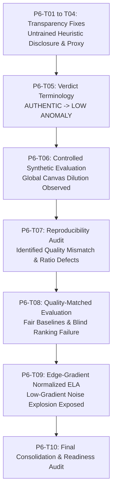

# SOET VeriTrust — Phase 6: Experimental Findings Consolidation (P6-T01 through P6-T09)

**Roadmap Phase:** Phase 6 — AI Forensic Evaluation  
**Consolidation Task:** P6-T10  
**Audit Date:** 2026-11-04  
**Scope:** Consolidated summary of all empirical experiments conducted to evaluate Error Level Analysis (ELA), convolutional neural network integration, spatial grid tiling, quality-matched baseline subtraction, and edge-gradient normalization.

---

## 1. Executive Summary of Experimental Journey

Across Phase 6, the SOET VeriTrust project progressed through nine systematic experimental stages to rigorously investigate whether statistical image compression forensics can detect credential manipulations (e.g. altered CGPA or candidate name):

---

## 2. Experiment-by-Experiment Analysis

### A. Global ELA Baseline & Synthetic Dataset Evaluation (P6-T06)
- **Objective:** Evaluate the production ELA pipeline on controlled synthetic samples to measure classification separation between clean certificates and localized splices.
- **Dataset:** 6 controlled samples ($1684 \times 1190\text{ px}$):
  - 3 Clean Baselines (`SAMPLE-01` Q95, `SAMPLE-02` Q90, `SAMPLE-03` Q80).
  - 3 Spliced Samples (`SAMPLE-04` CGPA patch Q75/98 $\rightarrow$ Q85; `SAMPLE-05` Name/CGPA raw text $\rightarrow$ Q90; `SAMPLE-06` double compression Q60/95 $\rightarrow$ Q80).
- **Results:**
  - All 6 samples (both clean and spliced) received near-identical global anomaly scores between **$0.234$ and $0.239$**.
  - All 6 received the identical verdict: `LOW ANOMALY`.
- **Root Cause Analysis:**
  1. **Canvas Area Dilution:** The spliced text patches occupied only $27,000\text{ px}$ to $71,000\text{ px}$ ($1.34\% - 3.5\%$) of the $2,003,960\text{ px}$ canvas. Averaging residual metrics across the entire canvas completely diluted the local anomaly signal.
  2. **Untrained CNN Inactivity:** The Kaiming-initialized CNN contributed a constant static logit (~$0.23$) to the weighted score, providing zero discriminative power.

---

### B. Spatial Tiled ELA Prototype (P6-T06 / P6-T07)
- **Objective:** Test whether spatial grid decomposition ($8 \times 8$ and $16 \times 16$) prevents canvas area dilution.
- **Methodology:**
  - Decomposed continuous ELA Euclidean magnitude maps into 64 tiles ($8 \times 8$, $\approx 210 \times 148\text{ px}$) and 256 tiles ($16 \times 16$, $\approx 105 \times 74\text{ px}$).
  - Calculated mean, standard deviation, and maximum per tile.
- **Key Findings:**
  1. **Local Separation Confirmed in `SAMPLE-04`:**  
     On a $16 \times 16$ grid, tiles overlapping the spliced CGPA patch showed an average residual of **$1.0234$** versus **$0.2697$** across background tiles ($3.79\times$ internal elevation). Peak tile mean reached $2.5807$.
  2. **$16 \times 16$ Outperformed $8 \times 8$:**  
     $16 \times 16$ tile dimensions ($\approx 74\text{ px}$ high) closely matched the height of single-line credential text ($50\text{ px}$), whereas $8 \times 8$ tiles ($\approx 148\text{ px}$ high) suffered from intra-tile dilution ($1.80\times$ elevation).
  3. **Supervised vs. Blind Limitation:**  
     This separation was observable only because the prototype used known ground-truth ROI coordinates. In authentic clean certificates, tiles containing institutional seals and bold headers generated natural tile means up to **$3.0 - 4.5$**, which overshadowed the splice.

---

### C. P6-T07 Reproducibility Audit Findings
- **Audit Findings:** An independent audit identified three critical methodological and reporting defects in the initial tiled prototype:
  1. **Hardcoded Narrative String Defect:** In `tiled_report.md`, text claimed global means of $0.312$ and $0.245$, whereas actual calculated JSON means were $0.3039$ and $0.6736$.
  2. **Misleading Ratio Artifact:** The report calculated a "Localized Signal Boost" as $\Delta_{\text{ROI}} / \Delta_{\text{non-ROI}}$. Because baseline clean certificates had higher global residuals than spliced certificates, both deltas were negative. Dividing two negative fractions yielded pseudo-positive ratios (e.g. $-0.0147 / -0.0022 = 6.68\times$) that misrepresented random noise as a strong detection boost.
  3. **Unfair Baseline Comparison:** `SAMPLE-04` (final export $Q=85$) had been compared against `SAMPLE-01` (final export $Q=95$). Probing with $Q=90$ caused the clean $Q=95$ baseline to exhibit high global truncation noise everywhere, rendering the differential comparison invalid.

---

### D. Quality-Matched ELA Evaluation (P6-T08)
- **Objective:** Re-evaluate matched-baseline subtraction using newly generated clean baselines with identical final JPEG quality ($Q=85$, $Q=90$, $Q=80$), and test unsupervised blind anomaly ranking.
- **Matched Baseline Subtraction Results:**
  - `PAIR-01` (`SAMPLE-04` vs `CLEAN-DEMO001-Q85`): Absolute difference in ROI was **$0.4602$** vs background **$0.1669$**, producing a confirmed **$+0.2932$ excess absolute anomaly**.
  - `PAIR-02` (`SAMPLE-05` vs `CLEAN-DEMO002-Q90`): Excess absolute anomaly was negligible ($+0.0258$).
  - `PAIR-03` (`SAMPLE-06` vs `CLEAN-DEMO003-Q80`): Excess absolute anomaly was subtle ($+0.0799$).
- **Blind Ranking Failure:**  
  When tiles were ranked descending by standardized residual Z-Score without providing ROI coordinates:
  - `SAMPLE-04` spliced tile ranked at **Rank #13** (out of 256).
  - `SAMPLE-05` spliced tile ranked at **Rank #25**.
  - `SAMPLE-06` spliced tile ranked at **Rank #17**.
  - In all 3 spliced certificates, **zero spliced tiles appeared in the Top 10 rankings**.
  - In all 3 clean certificates, the Top 10 rankings were **$100\%$ false positives** concentrated in the university seal and headers.

---

### E. Edge-Gradient Normalized ELA Investigation (P6-T09)
- **Objective:** Test whether dividing ELA residual by normalized Sobel image gradient ($\text{EGN} = \text{ELA} / (\epsilon + G_{\text{norm}})$) suppresses legitimate typography false positives.
- **Tested Parameters:** $\epsilon \in \{0.01, 0.05, 0.10, 0.50, 1.00\}$.
- **Empirical Findings:**
  1. **Aggressive Normalization ($\epsilon = 0.01$):**  
     In `SAMPLE-04`, the spliced CGPA patch jumped to **Rank #2**. However, on clean baselines (`CLEAN-DEMO001-Q85`), the denominator in flat margins ($G_{\text{norm}} \approx 0.0001$) exploded residual multiplier to $100.0$. Completely blank parchment margins at the bottom corners became **Rank #1 and Rank #2 false positives** (means $76.2$ and $74.5$).
  2. **Conservative Normalization ($\epsilon \ge 0.05$):**  
     Stopping background noise from exploding caused the denominator to be dominated by $\epsilon$. EGN-ELA collapsed back into raw ELA, leaving typography as false positives and dropping the `SAMPLE-04` splice back to Rank #11 – #13.
  3. **No Blind Detection Capability:**  
     No single $\epsilon$ setting achieved simultaneous suppression of typography and margin noise. EGN-ELA was conclusively deemed unviable for production.

---

## 3. Consolidated Benchmark Summary Across All Methods

| Evaluation Method | Global Canvas Scoring | Tiled ELA ($16 \times 16$) Supervised | Matched-Baseline Subtraction (Template Registered) | Blind Tiled Anomaly Ranking (Unsupervised) | Edge-Gradient Normalized ELA ($\epsilon=0.01$) |
|:---|:---:|:---:|:---:|:---:|:---:|
| **Detects Spliced CGPA (`SAMPLE-04`)** | ❌ Diluted ($0.30$) | ✅ Yes ($3.79\times$ ROI elevation) | ✅ Yes ($+0.293$ excess anomaly) | ❌ No (Rank #13, 0 in Top 10) | ⚠️ Partial (Rank #2, but breaks clean certs) |
| **Detects Uncompressed Text (`SAMPLE-05`)** | ❌ Diluted ($0.17$) | ⚠️ Weak ($0.13$ suppression) | ❌ Inconclusive ($+0.025$ delta) | ❌ No (Rank #25, 0 in Top 10) | ❌ No (Rank #23, 0 in Top 10) |
| **Detects Double Compression (`SAMPLE-06`)** | ❌ Diluted ($0.26$) | ⚠️ Subtle ($0.55$ vs $0.25$) | ⚠️ Subtle ($+0.079$ delta) | ❌ No (Rank #17, 0 in Top 10) | ❌ No (Rank #15, 0 in Top 10) |
| **False-Positive Immunity on Clean Certs** | ⚠️ Passive (All score Low) | ❌ High (Seals/Text score $3.0 - 4.5$) | ✅ High (Template cancels text) | ❌ Zero Immunity (Top 10 are 100% false pos) | ❌ Catastrophic (Blank margins explode to $76.0$) |
| **Production Feasibility** | ⚠️ Heuristic Baseline Only | ⚠️ Diagnostic Only (Needs ROI) | ⚠️ Requires Blank Template File | ❌ Unusable (Typography dominates) | ❌ Discarded (Margin noise explosion) |

---

## 4. Scientific Conclusion

1. **Heuristic Image Analysis Cannot Guarantee Authenticity:**  
   Error Level Analysis is an exploratory visualization technique. Because authentic certificate designs feature high-contrast seals, serif fonts, and registrar signatures, physical recompression residuals are heavily dominated by spatial edge frequency rather than tampering history.
2. **Defensible Project Claim:**  
   The SOET VeriTrust project can academically claim:
   - A fully functional, transparent, and decoupled ELA diagnostic service.
   - Rigorous, reproducible evaluation demonstrating the physical mechanisms of canvas dilution, residual suppression, and gradient division.
   - Absolute honesty in reporting that unsupervised blind ELA cannot replace cryptographic verification.

